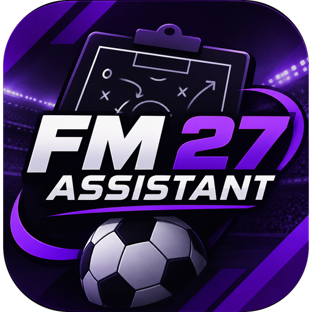

<p align="center"></p>

# FM27 Assistant

**L'assistant de Football Manager 27 : stats cachées, recrutement, tactique optimisée et entraînement réglé en un clic.**

FM27 Assistant est une application Windows qui tourne à côté de Football Manager 27. Elle lit ta partie pendant que tu joues
(potentiel, personnalité, fragilité… tout ce que FM cache) et, grâce au module **FM27 Bridge** installé dans le jeu,
elle peut aussi **appliquer ses réglages directement dans FM** : entraînement, tactique, onze de départ.

> Projet de fan indépendant, pour le jeu en solo. Sans lien avec Sports Interactive ni SEGA.

---

## Installation (Windows)

1. Télécharge **`FM27-Assistant-Setup.exe`** dans la [dernière release](../../releases/latest).
2. Ferme Football Manager 27, puis lance l'installeur.
3. Il trouve tout seul le dossier du jeu (Steam), puis :
   - installe **BepInEx 6** (chargeur de mods) et le module **FM27 Bridge** dans le jeu, console désactivée ;
   - installe l'application dans `%LOCALAPPDATA%\Programs\FM27 Assistant` ;
   - crée les raccourcis (menu Démarrer, bureau) et l'entrée dans *Applications installées* pour la désinstaller.
4. Lance FM27 : le **premier démarrage** prend 1 à 2 minutes de plus (BepInEx prépare le jeu une fois), ensuite c'est normal.
5. Ouvre **FM27 Assistant** et charge ta carrière : l'app se connecte et reconnaît ton club toute seule.

**Désinstaller** : *Paramètres Windows → Applications installées → FM27 Assistant*. FM27 Bridge est retiré du jeu et
BepInEx est désactivé ; tes réglages (`%APPDATA%\FM27Scout`) sont conservés.

### Et sur Mac ?

Pas de version Mac pour l'instant, pour deux raisons :
- **BepInEx ne prend pas en charge les jeux Unity IL2CPP sur macOS** (FM27 est un jeu IL2CPP) : sans lui, impossible de
  charger FM27 Bridge dans le jeu ;
- l'application est en WPF, une technologie d'interface propre à Windows.

---

## Fonctionnalités

### Mon club

| Page | Ce qu'elle fait |
|---|---|
| **Effectif** | Ton effectif complet avec attributs visibles **et cachés** (régularité, grands matchs, fragilité, ambition, professionnalisme…), CA/PA, valeur, contrat. Onglets équipe première / réserve / U21 / U18, tri sur toutes les colonnes, export CSV. |
| **Tactique** | Voir [Tactique](#tactique) ci-dessous. |
| **Entraînement** | Voir [Entraînement](#entraînement) ci-dessous. |
| **Vestiaire** | Les traits cachés de l'effectif : leaders, professionnels, joueurs à risque, profils à encadrer — pratique pour choisir un capitaine ou former des groupes d'encadrement. |

### Recrutement

| Page | Ce qu'elle fait |
|---|---|
| **Recherches** | Recherches prêtes à l'emploi sur toute la base (pépites, fins de contrat, joueurs libres, profils précis), modifiables dans `recherches.json`. |
| **Radar de scouting** | Tes critères (âge, postes sur un terrain cliquable, CA/PA, valeur, contrat, n'importe quelle stat) : le radar signale chaque nouveau joueur qui correspond, avec un badge dans le menu. |
| **Bonnes affaires** | Joueurs libres, fins de contrat à 6 ou 12 mois, meilleur rapport qualité/prix. |
| **Shortlist** | Les joueurs que tu suis : l'app note ce qui a changé depuis l'ajout (club, valeur, progression, contrat). |
| **Alertes d'effectif** | Ce qui cloche dans un effectif : contrats qui expirent, postes trop courts, joueurs fragiles ou en déclin. |
| **Comparateur** | Deux joueurs côte à côte, attribut par attribut, avec profil en radar. |
| **Fiche joueur** | Tout sur un joueur : potentiel, personnalité, fragilité, meilleurs rôles, historique de progression, joueurs similaires (plus jeunes / moins chers). |

La **barre du haut** cherche dans la base de ta partie (lue en direct dans FM, plus de 140 000 joueurs) : par nom de joueur ou de club, ton club en premier.

### Tactique

- L'app note les **90 configurations tactiques de FM27** (les 10 styles de FM × leurs 9 formations avec ballon / sans ballon)
  pour **ton** effectif et te conseille les 3 meilleures.
- La note combine : l'onze avec ballon (50 %), l'onze sans ballon (25 %) et le profil demandé par le style (25 % :
  par exemple endurance et activité pour le Gegenpress, passes et technique pour le Tiki-Taka).
- **Notation « meta »** (activée par défaut) : la vitesse, l'accélération et l'activité pèsent plus lourd, d'après les tests
  de la communauté (FM-Arena, sur FM26) qui les trouvent environ trois fois plus décisives que les autres attributs.
  Ce n'est pas confirmé par Sports Interactive pour FM27 : un clic repasse en notation « classique » par rôle.
- **Pieds** : lus dans FM — latéraux et milieux de côté préfèrent le pied du côté, ailiers offensifs le pied opposé (repiquer).
- **Blessés** écartés automatiquement.
- **Créer cette tactique dans FM** : nouvelle tactique dans le jeu (tes autres tactiques ne sont pas touchées) avec le style,
  les formations, les rôles et les consignes de FM, puis ton meilleur onze placé poste par poste.
  **Appliquer à la tactique active** (avec confirmation) ou **Placer seulement le meilleur onze** existent aussi.
- **Coups de pied arrêtés** : tireurs de corners et de coups francs (un classement par pied, comme dans FM), cibles aériennes,
  technique (rentrant / sortant) et zone visée selon le jeu de tête de tes cibles, défense en zone ou individuelle, joueurs
  qui restent devant, ordre des penaltys, touches longues. **Appliquer dans FM** règle d'un clic les tireurs de corners et de
  coups francs directs, la technique et la zone visée des corners ; le reste est conseillé avec les options exactes de FM27.
- **Efficacité tactique** (nouveauté de FM27) : ce qui fait monter chacune des quatre jauges et quelle fonction de l'app y aide.

### Entraînement

- **Plan sur 4 semaines** selon le calendrier et les besoins de l'équipe.
- **Entraînement individuel** : rôle conseillé, faiblesses à travailler, focus individuel.
- **Encadrement** : groupes de 3 (un jeune + deux mentors) choisis sur la personnalité.
- **Appliquer dans le jeu** — un clic, l'app lit l'état réel de tes joueurs dans FM et règle tout :
  - intensité de l'équipe et de chaque joueur (repos « Aucun travail » pour les fatigués, blessés laissés au centre médical) ;
  - affectation des entraîneurs selon leurs notes réelles, sans tout chambouler d'une semaine à l'autre ;
  - programme de chaque semaine (équilibré, avec ou sans ballon) ;
  - focus individuel sur les faiblesses de chaque joueur ;
  - groupes d'encadrement créés dans FM.
  Chaque partie se coche ou se décoche ; « Aperçu » montre tout sans rien changer.

### Confort

- **Ton club est détecté automatiquement** dans ta partie, et l'app **prend ses couleurs**.
- **Guide interactif** au premier lancement, puis une fiche d'aide la première fois que tu ouvres chaque page
  (« Revoir le guide » en bas du menu).
- Relecture automatique de la base toutes les 5 minutes, date de jeu estimée (modifiable).

---

## Comment ça marche

- **Lecture** : l'app lit la mémoire de FM27 (sans rien y écrire) pour la base de joueurs.
- **FM27 Bridge** (plugin BepInEx dans le jeu) : l'app lui parle en local (`127.0.0.1:27027`). Il lit les données affichées
  par l'interface de FM et envoie **les mêmes ordres que les menus du jeu** (comme si tu cliquais) : rien n'est modifié
  en dehors de ce que FM permet déjà.
- Données et réglages : `%APPDATA%\FM27Scout\` (`reglages.json`, `recherches.json`, `roles.json`, `journal.txt`…).

## Limites

- Windows uniquement, partie solo.
- Valeurs et salaires en £ (unité interne du jeu).
- Après une grosse mise à jour de FM27, certaines fonctions du module peuvent devoir être mises à jour.
- Les rôles et consignes individuelles sont ceux que FM associe au style choisi ; tu peux les ajuster dans le jeu.

---

## Compiler depuis les sources

Prérequis : Windows, [.NET 8 SDK](https://dotnet.microsoft.com/download), FM27 avec BepInEx 6 IL2CPP (bleeding edge) lancé une fois.

```powershell
# module du jeu (le chemin du jeu peut être passé avec -p:GamePath=...)
dotnet build FM27Bridge -c Release

# l'application (FM27ScoutApp/payload/bepinex.zip contient BepInEx + FM27 Bridge pour l'installeur ;
# après une modification du module, le régénérer avec scripts/make-payload.py "<dossier du jeu>")
dotnet publish FM27ScoutApp -c Release
```

L'exe produit (`FM27ScoutApp\bin\Release\net8.0-windows\win-x64\publish\FM27Scout.exe`) est l'application ;
renommé en `FM27-Assistant-Setup.exe` (ou lancé avec `--install`), il devient l'installeur.

Chaque push sur `main` compile l'installeur avec GitHub Actions et publie la release de la version indiquée
dans `FM27ScoutApp.csproj` (`<Version>`) si elle n'existe pas encore.

## Licence

Code sous licence [MIT](LICENSE). Composants tiers (BepInEx…) : voir [THIRD_PARTY.md](THIRD_PARTY.md).

---

<sub>dev by [@arress03](https://github.com/arress03)</sub>
